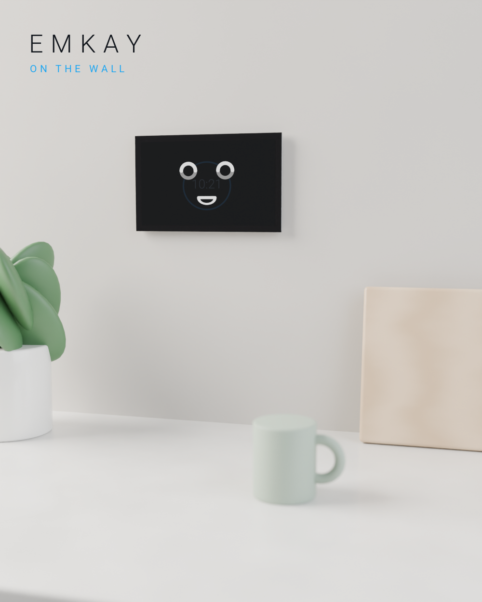
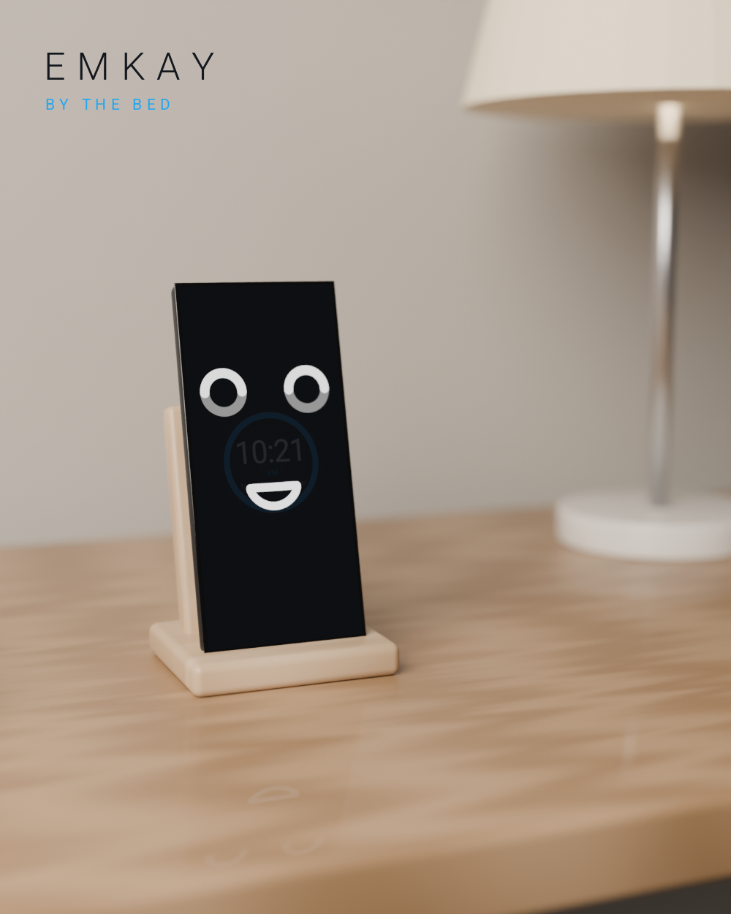
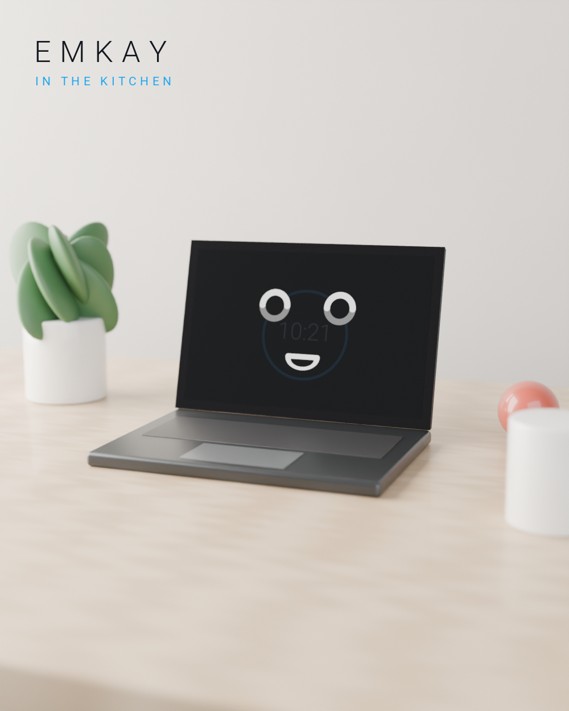
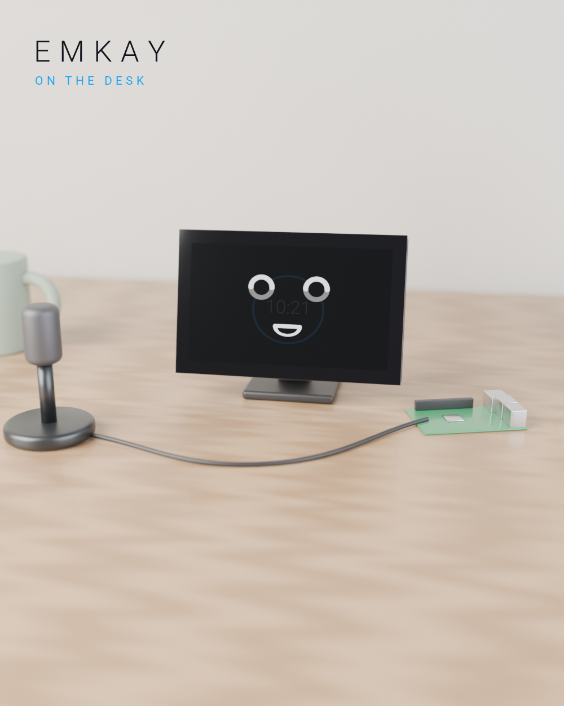

  

<h1 align="center">E M K A Y &nbsp; K I O S K</h1>

  How to give <a href="https://emkay.ai">Emkay</a> a fixed screen of its own: a tablet on the wall,
  a phone on the bedside table, an old laptop in the kitchen or a Raspberry Pi on the desk. 
  Step-by-step guides for each kind of device, and small helper scripts where a device needs them.

---

## The idea

[Emkay](https://github.com/emkay-voice/emkay) is OpenVoiceOS in a browser. You open
<https://app.emkay.ai> and it runs, with nothing to install. That is perfect for trying it, but an
assistant around the house should simply *be there*: always on, always listening for "Hey Emkay",
with its face on a screen that doesn't go to sleep, lock or wander off to another app.

Every device that can run Emkay can also do that. Phones, tablets and PCs all have a way to keep a
single app on the screen. They are called different things (Guided Access, app pinning, assigned
access, kiosk mode) and hide in different menus. This repository collects how to set each one up for
Emkay, so it becomes a standalone assistant that stands in one place.

Emkay stays the same everywhere. Nothing here changes what Emkay is or how it works. It only
makes a device into a good home for it.

  
  
  

## Guides

| Device | How | Helper |
|---|---|---|
| [**iPhone and iPad**](docs/ios.md) | Add to Home Screen + Guided Access | none needed |
| [**Android**](docs/android.md) phone or tablet | Install as an app + app pinning | none needed |
| [**Windows**](docs/windows.md) PC or laptop | Windows' own kiosk (assigned access) with Microsoft Edge | [`emkay-kiosk.ps1`](scripts/windows/emkay-kiosk.ps1) |
| [**Linux**](docs/linux.md), incl. **Raspberry Pi** | Chromium in kiosk mode, on your desktop or as a dedicated kiosk | [`emkay-kiosk.sh`](scripts/linux/emkay-kiosk.sh) |

## Before you start

A few things apply to every device:

- **Which Emkay?** Point the device at <https://app.emkay.ai>, or at your own
  [Emkay Home](https://github.com/emkay-voice/emkay-home) if you have one. A device that uses Emkay
  Home must trust Home's certificate first, as described in Emkay Home's README.
- **Can the device run it?** Emkay does speech on the device by default. That needs a fairly recent
  browser and some memory (roughly 6 GB or more for the best models; smaller devices get a lighter
  model). Emkay tells you on its first start if a device can't do it. You can then let your Emkay
  Home do the speech, or choose OpenVoiceOS' servers.
- **Keep the screen on.** Emkay comes with [ovos-skill-kiosk](https://github.com/emkay-voice/ovos-skill-kiosk):
  say *"Keep the screen on"* and *"Go full screen"*, or use the *Screen* page in the control panel.
  Then you don't need to turn off screen sleep in the device's own settings.
- **Microphone.** Phones, tablets and laptops have good microphones built in. For a PC or a
  Raspberry Pi, use a **USB microphone** or a USB conference speaker. They work without drivers on
  Windows, Linux and the Pi. Microphone boards (HATs) on the Pi's pins need their own drivers and
  are not covered here.
- **Mind the battery.** A phone or tablet that sits on its charger day and night ages its battery
  faster, and in rare cases the battery can swell. Turn on the charging limit if the device has one
  (often called *battery protection*, *charging optimisation* or *80 % limit*).

## Images

The pictures are rendered with Blender from [`render/`](render). Run `render/render_all.sh` to make
them again or change the scenes. The plain versions without the wordmark are in
[`images/plain/`](images/plain).

## Status

Early alpha, like Emkay itself. The guides follow each platform's own documentation, and the
helper scripts have a `--dry-run` (Linux) and `-WhatIf` (Windows) mode, so you can see what they
would change before they change anything. Reports of what works on your device are very welcome in
[Emkay's Discussions](https://github.com/emkay-voice/emkay/discussions).

## License

Apache-2.0
